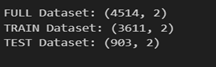
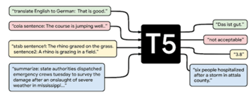
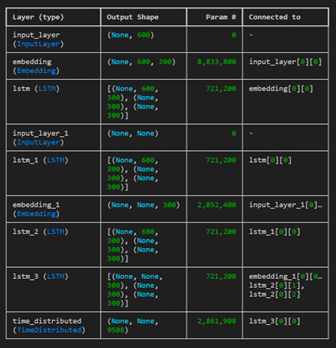
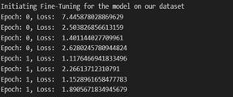
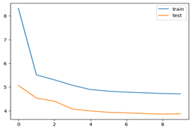
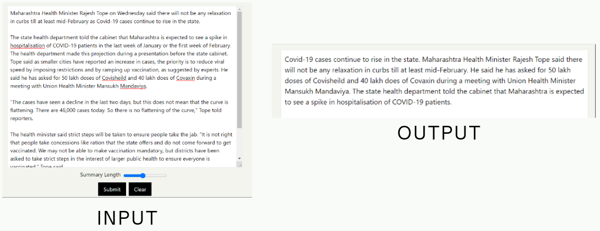

# News Summarization Using T5 Transformer and BiLSTM

## Overview
Readers often do not have time to read full news articles, while headlines alone are not enough to convey complete context. This project explores automatic summarization of news stories using:

- A Transformer-based approach (T5)
- An Encoder-Decoder BiLSTM baseline

The goal is to generate short, coherent, and informative summaries from long-form news content.

## Problem Statement
News organizations publish a large volume of stories daily, making manual summarization costly and difficult to scale. Automated summarization can improve content accessibility and user experience in news apps.

## Dataset info
The dataset is split into training and test sets before model training.

## Model Approaches

### 1. T5 Transformer
The T5 model is fine-tuned on the news summarization task. It produced more precise summaries than the BiLSTM baseline.

### 2. Encoder-Decoder BiLSTM
An Encoder-Decoder architecture with BiLSTM and embedding layers is implemented as a baseline.

## Training Insights

### Training Log Snapshot
Sample loss logs captured during fine-tuning:

### Loss Curve
Train and test loss trends across epochs:

## Results
- The Encoder-Decoder BiLSTM model reached around 46% accuracy.
- The fine-tuned T5 model generated more coherent and precise summaries.

## Repository Structure

- `code/`
  - `transformers-summarization-t5.ipynb`: T5 fine-tuning workflow
  - `LSTM_model.ipynb`: BiLSTM model training and evaluation
  - `evaluation/evaluation.ipynb`: Similarity-based evaluation and analysis
- `data/`: Dataset and split files
- `docs/`: Project images used in this README

## How To Use

1. Open `code/transformers-summarization-t5.ipynb` to run T5 fine-tuning.
2. Open `code/LSTM_model.ipynb` to train and evaluate the BiLSTM baseline.
3. Open `code/evaluation/evaluation.ipynb` to compute cosine similarity and review model outputs.

## References
- [T5 paper](https://arxiv.org/abs/1910.10683)
- [Hugging Face T5 documentation](https://huggingface.co/transformers/model_doc/t5.html)
- [News Summary dataset (Kaggle)](https://www.kaggle.com/sunnysai12345/news-summary)

## Conclusion
This project shows that Transformer-based summarization (T5) is more effective than the BiLSTM baseline for this dataset, producing higher-quality summaries with better coherence.